<div align="center">

# 🦾 ROBO HIN SDK

**SDK điều khiển tay máy cho ESP32 · A4988 · NEMA 17 · MT6701**


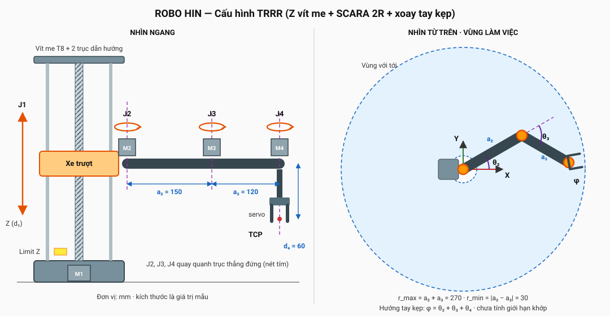

</div>

> Mục tiêu: một thư viện có **kiến trúc phân lớp rõ ràng**, API dễ dùng, an toàn, kiểm thử được, và dễ mở rộng sang phần cứng khác.

---

## 📑 Mục lục

1. [Tổng quan](#1-tổng-quan)
2. [Tính năng](#2-tính-năng)
3. [Phần cứng](#3-phần-cứng)
4. [Sơ đồ đấu dây & Pin map](#4-sơ-đồ-đấu-dây--pin-map)
5. [Kiến trúc SDK](#5-kiến-trúc-sdk)
6. [Cấu trúc thư mục](#6-cấu-trúc-thư-mục)
7. [Mô hình thời gian thực (FreeRTOS)](#7-mô-hình-thời-gian-thực-freertos)
8. [API sử dụng](#8-api-sử-dụng)
9. [Cấu hình robot](#9-cấu-hình-robot)
10. [Web điều khiển & giao thức](#10-web-điều-khiển--giao-thức)
11. [Hiệu chuẩn](#11-hiệu-chuẩn)
12. [An toàn & máy trạng thái](#12-an-toàn--máy-trạng-thái)
13. [Build, nạp và kiểm thử](#13-build-nạp-và-kiểm-thử)
14. [Quy ước code](#14-quy-ước-code)
15. [Lộ trình phát triển](#15-lộ-trình-phát-triển)
16. [Tài liệu tham khảo](#16-tài-liệu-tham-khảo)

---

## 1. Tổng quan

ROBO HIN là tay máy **TRRR** — 1 khớp **T**ịnh tiến + 3 khớp **R**otation — kiểu **SCARA có trục Z**, kèm 1 tay kẹp.

| Khớp | Loại | Tên | Chuyển động | Truyền động gợi ý | Đơn vị |
|:----:|:----:|-----|-------------|-------------------|:------:|
| J1 | **T** | Z (Lift) | Tịnh tiến lên / xuống | Vít me T8, 8 mm/vòng | mm |
| J2 | **R** | Shoulder | Xoay trong mặt phẳng ngang | Đai GT2 1:10 | ° |
| J3 | **R** | Elbow | Xoay trong mặt phẳng ngang (tiếp) | Đai GT2 1:8 | ° |
| J4 | **R** | Wrist | Xoay góc tay kẹp quanh trục đứng | Đai GT2 1:3 | ° |
| G  | — | Gripper | Kẹp / nhả | Servo RC (PWM) | % |

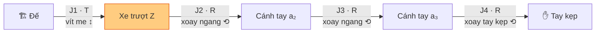

**Vì sao TRRR (SCARA + Z) hợp với stepper + A4988?**

| Đặc điểm | Lợi ích |
|----------|---------|
| Trọng lực chỉ tác động lên **trục Z** | J2–J4 quay trong mặt phẳng ngang → không phải "gánh" cánh tay → NEMA 17 đủ khỏe, ít mất bước |
| Z dùng vít me | Lực nâng lớn, độ phân giải cao (0.0025 mm/bước) |
| Động học đơn giản | IK **giải tích** chính xác, tính rất nhanh trên ESP32 |
| Tách biệt Z và XY | Dễ hiệu chuẩn, dễ debug từng phần |

### 1.1 Toàn cảnh hệ thống

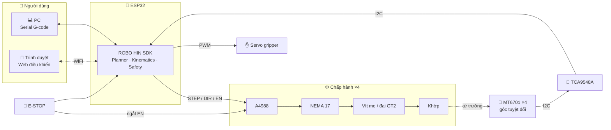

<p align="center"><a href="#10-web-điều-khiển--giao-thức">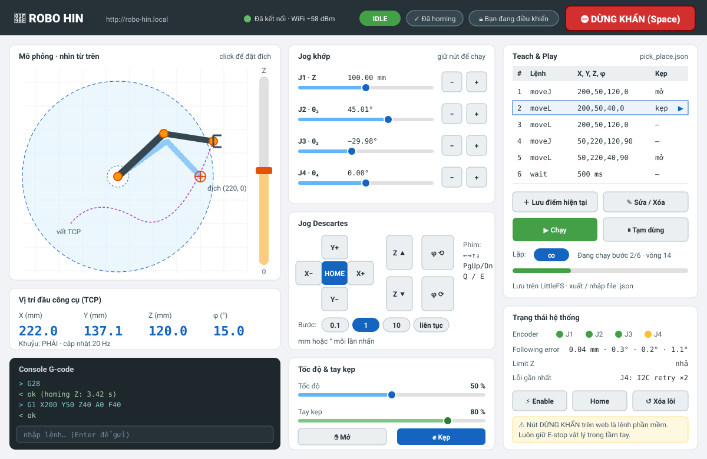</a><br/><sub>Giao diện web điều khiển — xem <a href="#10-web-điều-khiển--giao-thức">mục 10</a></sub></p>

### 1.2 Ý tưởng cốt lõi: khép vòng cho driver vòng hở

A4988 chỉ nhận xung STEP/DIR, **không biết** động cơ có quay đúng hay không. SDK dùng MT6701 đo góc thật của khớp để **khép vòng ở mức vị trí**:

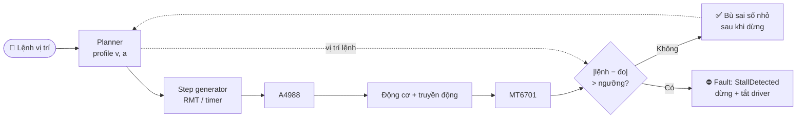

| Lợi ích | Nhờ đâu |
|---------|---------|
| ✅ J2–J4 không cần homing khi khởi động | Encoder **tuyệt đối** gắn sau bộ truyền |
| ✅ J1 chỉ homing 1 lần mỗi lần bật nguồn | Limit Z + encoder đếm vòng trên trục vít |
| ✅ Phát hiện mất bước / kẹt | So sánh vị trí lệnh và vị trí đo (*following error*) |
| ✅ Vị trí cuối chính xác | Bù sai số sau mỗi chuyển động |

---

## 2. Tính năng

| Nhóm | Tính năng | v1.0 | Tương lai |
|------|-----------|:----:|:---------:|
| Chuyển động | Phát xung STEP bằng phần cứng (RMT / timer ISR) | ✅ | |
| | Đồng bộ đa trục, hàng đợi không chặn | ✅ | |
| | Profile hình thang | ✅ | |
| | Profile S-curve | | ⏳ |
| Encoder | MT6701 qua I2C + mux TCA9548A, kiểm tra tính hợp lý | ✅ | |
| | Đếm vòng (multi-turn) cho trục vít J1 | ✅ | |
| Động học | FK / IK giải tích SCARA TRRR, `moveL` | ✅ | |
| | Chọn nghiệm khuỷu trái / phải, tránh kỳ dị | ✅ | |
| Homing | J1 bằng limit Z (nhanh → lùi → chậm) | ✅ | |
| An toàn | E-stop, soft limit, following error, watchdog | ✅ | |
| Lưu trữ | Hiệu chuẩn vào NVS | ✅ | |
| Web | Giao diện web: mô phỏng, jog, tay kẹp, console | ✅ | |
| | Teach & Play lưu trên LittleFS | ✅ | |
| | Deadman heartbeat, khóa điều khiển, mật khẩu | ✅ | |
| | Cập nhật firmware OTA qua web | ✅ | |
| Giao tiếp | Serial G-code, WebSocket JSON, REST | ✅ | |
| | micro-ROS / ROS 2 | | ⏳ |
| Phần cứng | Driver TMC2209 qua cùng interface | | ⏳ |
| Kiểm thử | Unit test trên PC (`env:native`) | ✅ | |

---

## 3. Phần cứng

### 3.1 Danh sách linh kiện (BOM)

| Linh kiện                        | SL       | Ghi chú                                            |
|----------------------------------|:--------:|----------------------------------------------------|
| ESP32 DevKit V1 (ESP32-WROOM-32) | 1        | `board = esp32dev`                                 |
| Driver A4988 + tản nhiệt         | 4        | Chỉnh dòng bằng Vref                               |
| Động cơ bước NEMA 17 (42 mm)     | 4        | 1.8°/bước (200 bước/vòng), 1.5–2 A                 |
| Module MT6701 (GND/VDD/OUT/SCL/SDA) | 4     | I2C 14-bit, kèm nam châm **từ hóa xuyên tâm**      |
| Module TCA9548A                  | 1        | Mux I2C 8 kênh — vì mọi MT6701 cùng địa chỉ 0x06   |
| Vít me T8 + đai ốc đồng          | 1        | J1 · bước 8 mm (hoặc 2 mm nếu cần tự hãm)          |
| Khớp nối mềm 5×8 mm              | 1        | Trục động cơ ↔ vít me                              |
| Trục dẫn hướng Ø8 + LM8UU        | 2 + 4    | Dẫn hướng xe trượt Z                               |
| Đai GT2 + puly 20T / 60–200T      | 3 bộ     | Giảm tốc J2, J3, J4                                |
| Vòng bi đỡ trục (608 / 6001…)    | ≥ 6      | Các khớp quay                                      |
| Servo MG996R / SG90              | 1        | Tay kẹp                                            |
| Nguồn 12 V / 24 V, ≥ 5 A          | 1        | VMOT                                               |
| Buck 5 V (≥ 2 A)                 | 1        | ESP32 + servo                                      |
| Tụ hóa 100 µF / 35 V             | 1/driver | Sát chân VMOT–GND của mỗi A4988                    |
| Nút E-stop (tiếp điểm NC)        | 1        | **Bắt buộc**                                       |
| Công tắc hành trình (limit)      | 1–2      | **Bắt buộc** ≥ 1 cho homing J1 (đáy Z)             |

### 3.2 Lưu ý về A4988

**Bảng vi bước (MS1/MS2/MS3 bằng jumper):**

| MS1 | MS2 | MS3 | Chế độ | Bước/vòng động cơ |
|:---:|:---:|:---:|:------:|:-----------------:|
| L | L | L | Full   | 200  |
| H | L | L | 1/2    | 400  |
| L | H | L | 1/4    | 800  |
| H | H | L | 1/8    | 1600 |
| H | H | H | **1/16** (mặc định) | **3200** |

**Đặt dòng:** `I_max = Vref / (8 × Rs)`

| Loại module | Rs | Vref cho 1.0 A | Vref cho 1.5 A |
|-------------|:--:|:--------------:|:--------------:|
| Pololu      | 0.068 Ω | 0.54 V | 0.82 V |
| Clone phổ biến | 0.1 Ω | 0.80 V | 1.20 V |

> ⚠️ **Kiểm tra giá trị Rs in trên board** trước khi chỉnh. **Không bao giờ** rút/cắm dây động cơ khi driver đang có nguồn.

- Xung STEP tối thiểu 1 µs cao / 1 µs thấp; DIR phải ổn định ≥ 200 ns trước cạnh lên STEP.
- `RESET` và `SLEEP` nối với nhau nếu không dùng.

### 3.3 Lưu ý về MT6701

Module dùng trong dự án chỉ có 5 chân: **GND · VDD · OUT (analog) · SCL · SDA** → SDK đọc góc qua **I2C**.

<p align="center">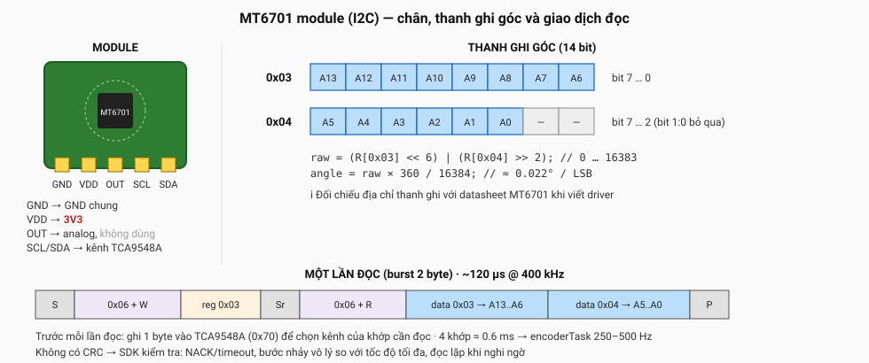</p>

**Vấn đề:** mọi MT6701 có **cùng địa chỉ I2C `0x06`** → 4 con trên 1 bus sẽ xung đột. **Giải pháp:** mux **TCA9548A** — mỗi encoder 1 kênh riêng, ESP32 chọn kênh trước khi đọc.

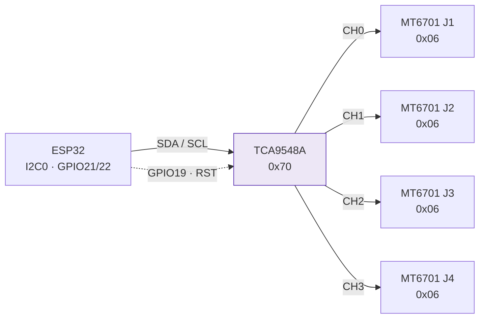

| Phương án đọc | Dùng? | Lý do |
|---------------|:-----:|-------|
| **I2C + TCA9548A** | ⭐ **Mặc định** | 14 bit số, chống nhiễu tốt, chỉ tốn 2 chân + 1 chân reset mux |
| Chân OUT analog → ADC ESP32 | ✖ | ADC ESP32 nhiễu & phi tuyến (thực tế ~9–10 bit), ADC2 không dùng được khi bật WiFi, thiếu chân ADC1 cho 4 encoder |
| 2 bus I2C phần cứng | ✖ | Mỗi bus vẫn chỉ chứa được 1 MT6701 → chỉ đủ 2 encoder |

**I2C không có CRC** → driver `MT6701I2c` tự bảo vệ:

| Kiểm tra | Xử lý |
|----------|-------|
| NACK / timeout trên bus | Thử lại 1 lần → lỗi liên tiếp > N lần → `Fault::EncoderError` |
| Bus treo (SDA bị giữ LOW) | Phát 9 xung SCL + reset TCA9548A qua GPIO19 |
| Góc nhảy lớn hơn `vmax × dt` | Bỏ mẫu, đọc lại; lặp lại → lỗi |
| Giá trị đứng yên khi đang chạy | Nghi mất nam châm / encoder treo → so với following error |

> ⚠️ **Cấp VDD = 3V3**, không cấp 5V: nhiều module có sẵn điện trở kéo lên SDA/SCL về VDD, nếu là 5V sẽ đưa 5V vào chân ESP32.
> Nếu dây dài (> 30 cm) hoặc nhiễu từ động cơ: dùng dây xoắn đôi, giảm xuống 100 kHz, pull-up 2.2–4.7 kΩ.

> ℹ️ Địa chỉ thanh ghi góc (0x03/0x04) và tần số I2C tối đa cần đối chiếu lại datasheet MT6701 khi viết driver.

**Ngân sách thời gian đọc (400 kHz):**

| Bước | Thời gian |
|------|:---------:|
| Chọn kênh TCA9548A (ghi 1 byte) | ~30 µs |
| Đọc 2 byte góc (burst) | ~120 µs |
| **1 khớp** | **~150 µs** |
| **4 khớp** | **~0.6 ms** → `encoderTask` chạy 250–500 Hz |

> J1 cần **đếm vòng** trên trục vít: giữa 2 lần đọc, trục vít phải quay < ½ vòng. Ở 40 mm/s (5 vòng/s) và 250 Hz → 0.02 vòng/mẫu ✅

**Vị trí gắn encoder cho từng khớp:**

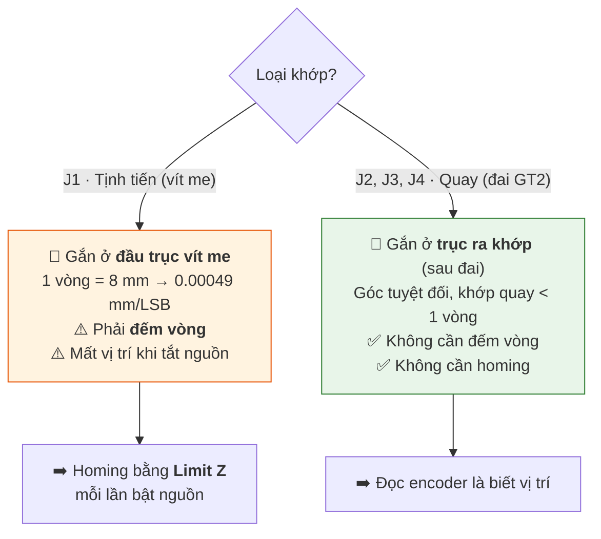

---

## 4. Sơ đồ đấu dây & Pin map

<p align="center">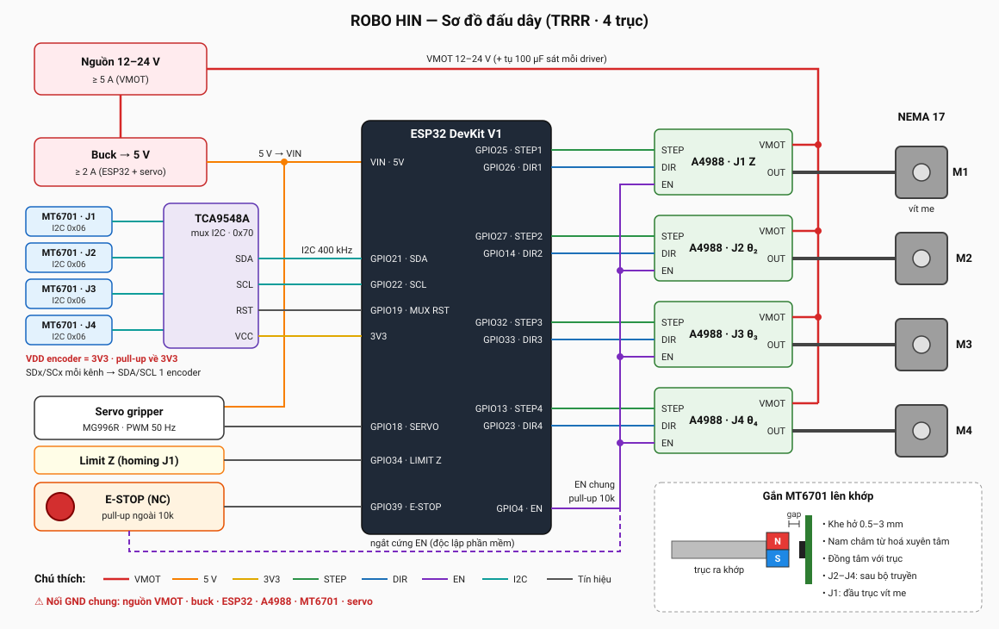</p>

| Chức năng                  | GPIO          | Ghi chú                                       |
|----------------------------|:-------------:|-----------------------------------------------|
| J1 (Z) STEP / DIR          | 25 / 26       | Vít me                                        |
| J2 (θ₂) STEP / DIR         | 27 / 14       |                                               |
| J3 (θ₃) STEP / DIR         | 32 / 33       |                                               |
| J4 (θ₄) STEP / DIR         | 13 / 23       |                                               |
| ENABLE chung (active-LOW)  | 4             | Pull-up 10 kΩ → driver **tắt** khi ESP32 reset |
| I2C SDA / SCL (encoder)    | 21 / 22       | Qua TCA9548A (0x70), pull-up 4.7 kΩ về 3V3    |
| TCA9548A RESET             | 19            | Gỡ treo bus I2C                               |
| Servo gripper              | 18            | LEDC PWM 50 Hz                                |
| *(còn trống)*              | 5, 16, 17     | Dự phòng: limit, LED, buzzer…                 |
| E-stop                     | 39            | Input-only, pull-up ngoài, tiếp điểm NC       |
| Limit Z dưới (homing J1)   | 34            | **Bắt buộc** · input-only, pull-up ngoài      |
| Limit Z trên               | 35            | Tùy chọn · giới hạn cứng                      |

**Chân ESP32 cần tránh:**

| GPIO | Vấn đề |
|------|--------|
| 🚫 6–11 | Nối flash SPI — **không dùng** |
| ⚠️ 34–39 | Chỉ input, không có pull-up nội |
| ⚠️ 0, 2, 5, 12, 15 | Strapping pin — ảnh hưởng chế độ khởi động |
| 🔥 **12** | **Phải LOW khi boot**, nếu không flash chạy 1.8 V → không khởi động |

---

## 5. Kiến trúc SDK

Mỗi lớp chỉ phụ thuộc lớp dưới qua **interface** → thay phần cứng (vd. A4988 → TMC2209) mà không sửa logic chuyển động.

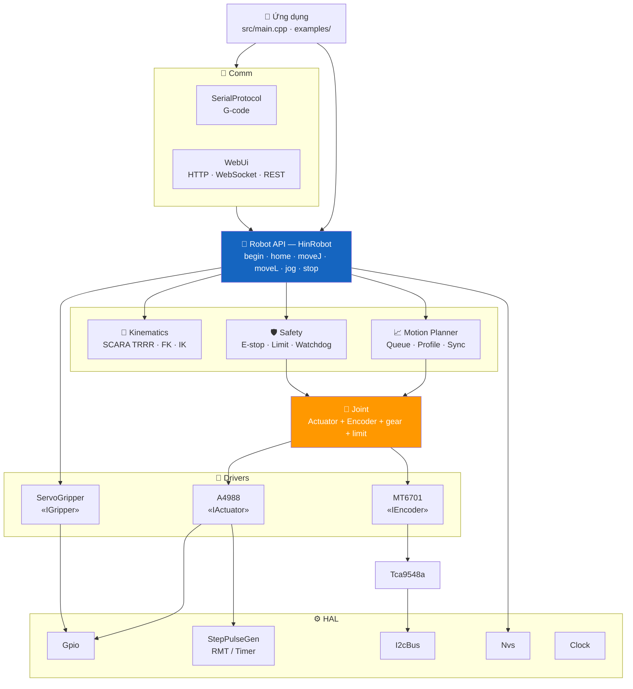

### 5.1 Các interface chính

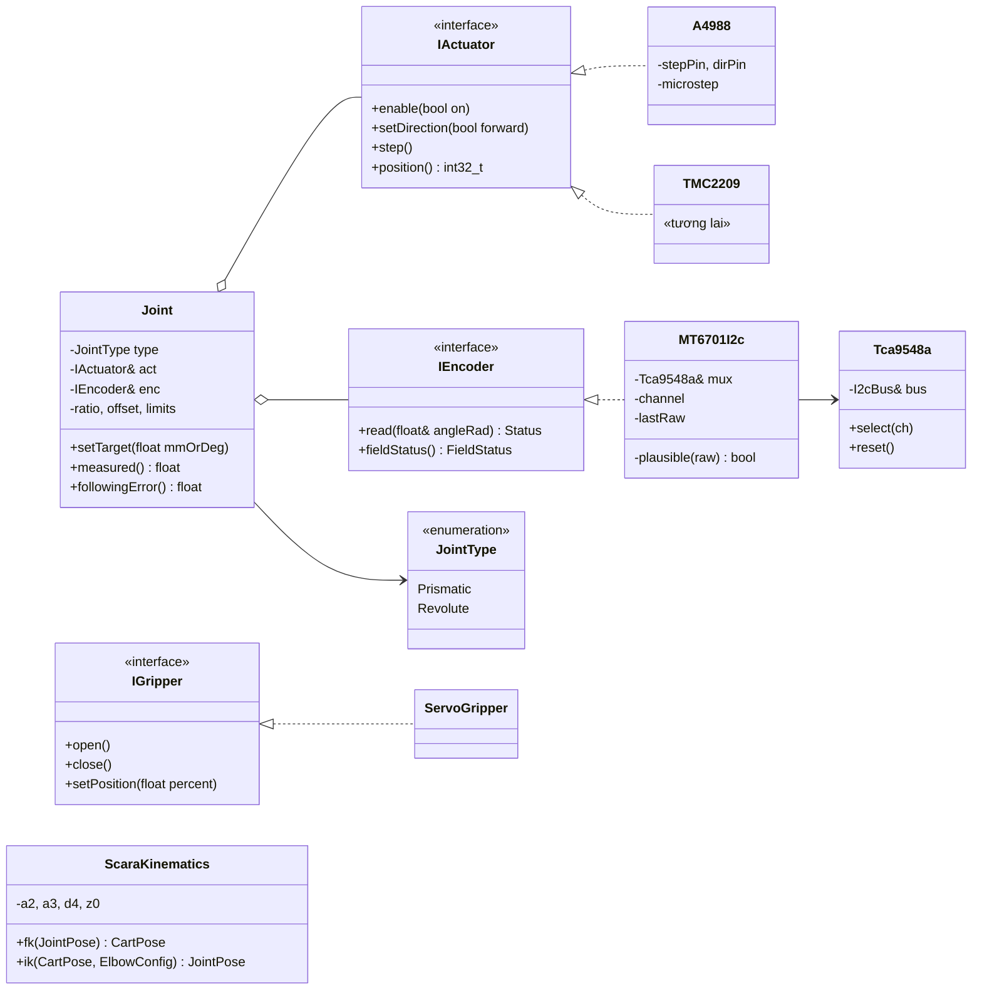

### 5.2 Trách nhiệm từng module

| Module | Trách nhiệm |
|--------|-------------|
| `hal/StepPulseGen` | Sinh xung STEP bằng RMT hoặc `gptimer` ISR (IRAM). **Không** dùng `delayMicroseconds()`. |
| `drivers/A4988` | STEP/DIR/EN, độ trễ setup DIR, số microstep. |
| `drivers/MT6701I2c` | Đọc 14 bit góc qua I2C, kiểm tra tính hợp lý, lọc nhiễu, đếm vòng (J1). |
| `drivers/Tca9548a` | Chọn kênh mux, reset & gỡ treo bus. |
| `core/Joint` | Khớp **tịnh tiến** (mm) hoặc **quay** (°); đổi đơn vị ↔ microstep ↔ tick; tỉ số truyền / bước vít, chiều, offset, giới hạn. |
| `core/Homing` | Homing J1: chạy nhanh về limit Z → lùi → tiếp cận chậm → đặt gốc Z. |
| `motion/Profile` | Profile hình thang / S-curve theo `vmax`, `amax` (`jmax`). |
| `motion/Planner` | Đồng bộ đa trục, hàng đợi lệnh, nội suy Descartes cho `moveL`. |
| `kinematics/` | FK / IK giải tích SCARA TRRR. Thuần C++, **không phụ thuộc Arduino** → test trên PC. |
| `safety/` | E-stop, soft limit, following error, watchdog, quản lý lỗi. |
| `storage/` | Lưu/đọc hiệu chuẩn trên NVS. |
| `comm/` | Parser Serial G-code; `WebUi`: web server, WebSocket, REST, khóa điều khiển, heartbeat; `WifiManager`: STA / AP + mDNS. |
| `storage/Programs` | Đọc / ghi chương trình teach (`.json`) trên LittleFS. |

### 5.3 Profile vận tốc

<p align="center">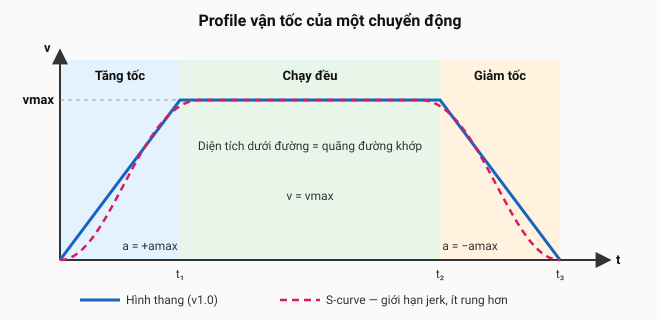</p>

**Đồng bộ đa trục:** khớp có quãng đường dài nhất quyết định thời gian `T`; các khớp còn lại được giảm `vmax`/`amax` theo tỉ lệ để **cùng bắt đầu và cùng kết thúc** → đầu công cụ chuyển động mượt, không giật.

```mermaid
gantt
    title Ví dụ moveJ — mọi khớp kết thúc cùng lúc
    dateFormat X
    axisFormat %s
    section J1 (ΔZ 40 mm)
    tăng tốc   :a1, 0, 2
    chạy đều   :a2, 2, 8
    giảm tốc   :a3, 8, 10
    section J2 (Δ90° — dài nhất)
    tăng tốc   :b1, 0, 2
    chạy đều   :b2, 2, 8
    giảm tốc   :b3, 8, 10
    section J3 (Δ30°)
    tăng tốc   :c1, 0, 2
    chạy đều   :c2, 2, 8
    giảm tốc   :c3, 8, 10
    section J4 (Δ15°)
    tăng tốc   :d1, 0, 2
    chạy đều   :d2, 2, 8
    giảm tốc   :d3, 8, 10
```

### 5.4 Động học TRRR (SCARA)

Nhìn [hình đầu trang](#-robo-hin-sdk): J1 nâng hạ cả cánh tay, J2–J4 cùng quay quanh trục **thẳng đứng** → bài toán tách thành **Z độc lập** + **cánh tay phẳng 2 khâu** + **góc tay kẹp**.

**Bảng Denavit–Hartenberg** (biến khớp có dấu \*):

| i | Loại | θᵢ | dᵢ | aᵢ | αᵢ |
|:-:|:----:|:--:|:--:|:--:|:--:|
| 1 | T | 0 | **d₁\*** | 0 | 0 |
| 2 | R | **θ₂\*** | 0 | a₂ = 150 | 0 |
| 3 | R | **θ₃\*** | 0 | a₃ = 120 | 0 |
| 4 | R | **θ₄\*** | −d₄ = −60 | 0 | 0 |

**Động học thuận (FK)** — biết khớp → tính vị trí tay kẹp:

$$x = a_2\cos\theta_2 + a_3\cos(\theta_2+\theta_3)$$
$$y = a_2\sin\theta_2 + a_3\sin(\theta_2+\theta_3)$$
$$z = z_0 + d_1 - d_4 \qquad \varphi = \theta_2+\theta_3+\theta_4$$

**Động học nghịch (IK)** — biết `(x, y, z, φ)` → tính khớp:

$$\cos\theta_3 = \frac{x^2+y^2-a_2^2-a_3^2}{2\,a_2a_3} \quad\Rightarrow\quad \theta_3 = \pm\arccos(\cdot)$$
$$\theta_2 = \operatorname{atan2}(y,x) - \operatorname{atan2}\big(a_3\sin\theta_3,\; a_2 + a_3\cos\theta_3\big)$$
$$d_1 = z - z_0 + d_4 \qquad \theta_4 = \varphi - \theta_2 - \theta_3$$

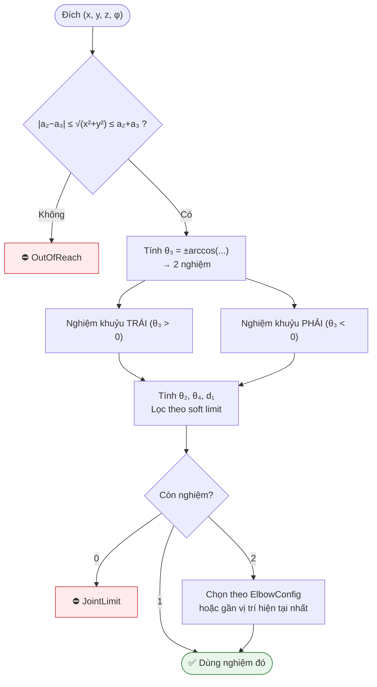

> ⚠️ **Điểm kỳ dị:** khi θ₃ ≈ 0° (tay duỗi thẳng) hoặc đích gần tâm (r ≈ |a₂ − a₃|), một chuyển động nhỏ ở XY đòi hỏi J2/J3 quay rất nhanh. `moveL` sẽ tự giảm tốc hoặc từ chối đi qua vùng này.

---

## 6. Cấu trúc thư mục

```
ROBO_HIN/
├── platformio.ini
├── README.md
├── include/
│   └── robot_config.h           # cấu hình robot cụ thể (pin, DH, giới hạn)
├── src/
│   └── main.cpp                 # firmware chính dùng SDK
├── lib/
│   └── HinRobotSDK/
│       ├── library.json
│       └── src/
│           ├── HinRobot.h       # header tổng — chỉ cần #include cái này
│           ├── HinRobot.cpp
│           ├── common/          # Types, Status, Units, Math
│           ├── hal/             # Gpio, StepPulseGen, I2cBus, Nvs, Clock
│           ├── drivers/         # A4988, MT6701I2c, Tca9548a, ServoGripper
│           ├── core/            # Joint, JointConfig, Homing
│           ├── motion/          # Profile, Planner, MotionQueue
│           ├── kinematics/      # ScaraKinematics (FK/IK TRRR)
│           ├── safety/          # SafetyMonitor, EStop, Limits
│           ├── storage/         # CalibrationStore, Programs (LittleFS)
│           └── comm/            # SerialProtocol, WebUi, WifiManager
├── examples/
│   ├── 01_single_stepper/       # quay 1 động cơ, không encoder
│   ├── 02_read_mt6701/          # quét I2C, đọc góc 4 encoder qua TCA9548A
│   ├── 03_joint_closed_loop/    # 1 khớp + encoder, phát hiện mất bước
│   ├── 04_homing_z/             # homing J1 bằng limit Z + đếm vòng vít me
│   ├── 05_multi_axis_moveJ/     # đồng bộ 4 trục
│   ├── 06_scara_moveL/          # IK + chuyển động thẳng trong XY
│   ├── 07_serial_gcode/         # điều khiển qua Serial
│   └── 08_web_control/          # WiFi + web điều khiển đầy đủ
├── data/                        # → LittleFS (pio run -t uploadfs)
│   ├── www/                     # index.html, app.js, style.css (nén .gz)
│   └── programs/                # chương trình teach mẫu
├── tools/
│   └── gzip_www.py              # nén file web trước khi uploadfs
├── test/
│   ├── test_kinematics/         # chạy trên PC (env:native)
│   ├── test_profile/
│   └── test_mt6701_decode/      # giải mã góc, đếm vòng, lọc bước nhảy
└── docs/
    ├── images/                  # wiring.svg, robot_arm.svg, web_ui.svg, ...
    ├── protocol.md
    └── calibration.md
```

---

## 7. Mô hình thời gian thực (FreeRTOS)

ESP32 có 2 nhân: **core 1** dành riêng cho điều khiển thời gian thực, **core 0** cho WiFi và giao tiếp → WiFi không làm rung xung bước.

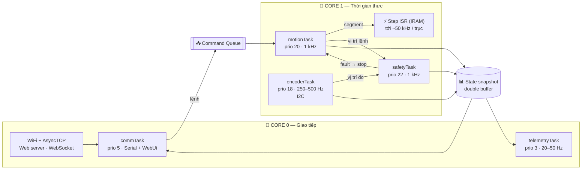

| Quy tắc trong ISR | |
|---|---|
| ✅ `IRAM_ATTR`, chỉ thao tác GPIO và bộ đếm | ❌ `Serial.print`, `malloc`, `new` |
| ✅ Biến chia sẻ là `volatile` / atomic | ❌ Gọi API FreeRTOS không có hậu tố `FromISR` |

---

## 8. API sử dụng

### 8.1 Ví dụ tối thiểu

```cpp
#include <Arduino.h>
#include <HinRobot.h>
#include "robot_config.h"

hin::HinRobot robot(ROBOT_CONFIG);

void setup() {
    Serial.begin(115200);

    if (robot.begin() != hin::Status::Ok) {
        Serial.println(robot.lastErrorString());
        while (true) delay(1000);
    }

    robot.enable();
    robot.home();             // J1: chạy về limit Z · J2–J4: đọc encoder tuyệt đối
}

void loop() {
    // Không gian khớp: { Z (mm), θ2 (°), θ3 (°), θ4 (°) }, 50% tốc độ tối đa
    robot.moveJ({100, 45, -30, 0}, hin::Speed::percent(50));

    // Pick & place — Descartes: { x, y, z (mm), φ góc tay kẹp (°) }
    robot.moveL({200,  50, 120, 0}, hin::Speed::mmPerSec(60));   // tới trên vật
    robot.moveL({200,  50,  40, 0}, hin::Speed::mmPerSec(20));   // hạ Z
    robot.gripper().close();
    robot.moveL({200,  50, 120, 0}, hin::Speed::mmPerSec(20));   // nâng Z
    robot.moveL({ 50, 220, 120, 90}, hin::Speed::mmPerSec(60));  // tới vị trí thả, xoay 90°
    robot.gripper().open();
    robot.waitIdle();
}
```

### 8.2 Một lệnh `moveJ` đi qua SDK như thế nào

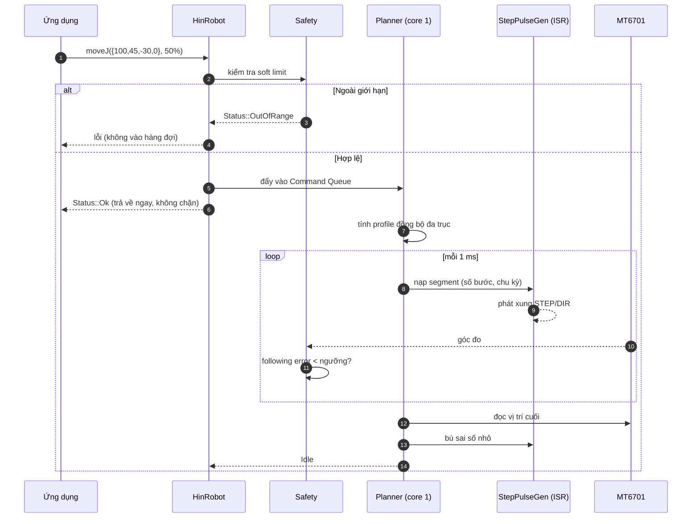

### 8.3 Danh sách API chính

| Nhóm | Hàm | Mô tả |
|------|-----|-------|
| 🔧 Khởi tạo | `Status begin()` | Khởi tạo HAL, driver, đọc encoder, nạp hiệu chuẩn |
| | `enable()` / `disable()` | Bật/tắt dòng động cơ |
| 🏠 Homing | `Status home()` | J1 về limit Z, J2–J4 đọc encoder tuyệt đối |
| | `bool isHomed()` | Đã homing J1 chưa |
| 🏃 Chuyển động | `Status moveJ(JointPose, Speed)` | `{z, θ2, θ3, θ4}` — đồng bộ, **không chặn** |
| | `Status moveL(CartPose, Speed)` | `{x, y, z, φ}` — đường thẳng Descartes |
| | `setElbow(ElbowConfig)` | Chọn nghiệm IK: `Left` / `Right` / `Nearest` |
| | `Status jog(JointId, float vel)` | Chạy tay liên tục (mm/s cho J1, °/s cho J2–J4) |
| | `stop()` | Dừng có giảm tốc |
| | `emergencyStop()` | Dừng ngay, tắt driver |
| | `isIdle()` / `waitIdle()` | Trạng thái hàng đợi |
| 📊 Trạng thái | `JointPose jointPositions()` | Vị trí đo từ encoder (mm / độ) |
| | `CartPose toolPose()` | FK từ vị trí hiện tại |
| | `RobotState state()` | Xem [máy trạng thái](#122-máy-trạng-thái-robot) |
| | `Fault lastFault()` | Mã lỗi gần nhất |
| 🎯 Hiệu chuẩn | `Status calibrateZero(JointId)` | Lấy vị trí hiện tại làm 0 |
| | `Status saveCalibration()` | Ghi NVS |
| 📐 Động học | `bool fk(const JointPose&, CartPose&)` | Động học thuận |
| | `bool ik(const CartPose&, JointPose&)` | Động học nghịch (false nếu ngoài tầm với) |

> **Đơn vị:** API công khai dùng **mm** (J1, x, y, z) và **độ** (J2–J4, φ); nội bộ dùng **m** và **rad**. Mọi hàm trả `hin::Status`, không dùng exception.

### 8.4 Dùng từng lớp riêng lẻ

```cpp
hin::I2cBus    bus(/*port*/0, /*sda*/21, /*scl*/22, /*hz*/400'000);
hin::Tca9548a  mux(bus, /*addr*/0x70, /*rstPin*/19);
hin::MT6701I2c enc(mux, /*channel*/1);       // encoder J2

float angle;
if (enc.read(angle) == hin::Status::Ok) {
    Serial.printf("Goc: %.2f deg, tu truong: %s\n",
                  hin::rad2deg(angle), hin::toString(enc.fieldStatus()));
}
```

---

## 9. Cấu hình robot

Toàn bộ tham số đặc thù nằm trong **một** file `include/robot_config.h`:

```cpp
#pragma once
#include <HinRobot.h>

using hin::JointType::Prismatic;
using hin::JointType::Revolute;
using hin::EncoderMount::Screw;
using hin::EncoderMount::Output;

constexpr hin::JointConfig JOINTS[] = {
// name       type       step dir ch  µstep ratio       encMount invert  min   max   vmax  amax
//                                          (T: mm/vòng
//                                           R: tỉ số đai)                (mm | °)  (/s)  (/s²)
  {"z",        Prismatic, 25,  26, 0,  16,   8.0f,       Screw,   false,  0,    200,  40,   200},
  {"shoulder", Revolute,  27,  14, 1,  16,  10.0f,       Output,  false, -135,  135,  90,   180},
  {"elbow",    Revolute,  32,  33, 2,  16,   8.0f,       Output,  false, -145,  145,  120,  240},
  {"wrist",    Revolute,  13,  23, 3,  16,   3.0f,       Output,  false, -180,  180,  180,  360},
};

// Hình học SCARA (mm) — xem hình đầu trang
constexpr hin::ScaraGeometry GEOMETRY = {
    .a2 = 150.0f,   // J2 → J3
    .a3 = 120.0f,   // J3 → J4
    .d4 =  60.0f,   // mặt bích J4 → đầu tay kẹp (hướng xuống)
    .z0 =  80.0f,   // độ cao cánh tay khi d1 = 0
};

constexpr hin::HomingConfig HOMING = {
    .joint      = 0,       // J1
    .limitPin   = 34,
    .direction  = -1,      // chạy xuống
    .fastMmS    = 10.0f,
    .slowMmS    = 2.0f,
    .backoffMm  = 3.0f,
    .timeoutMs  = 30000,
};

constexpr hin::RobotConfig ROBOT_CONFIG = {
    .joints            = JOINTS,
    .jointCount        = 4,
    .geometry          = GEOMETRY,
    .homing            = HOMING,
    .enablePin         = 4,
    .encoderBus        = {.port = 0, .sda = 21, .scl = 22, .hz = 400'000,
                          .muxAddr = 0x70, .muxResetPin = 19},   // ch = kênh TCA9548A
    .gripperPin        = 18,
    .estopPin          = 39,
    .followingErrorMm  = 0.5f,   // J1 — vượt ngưỡng → Fault::StallDetected
    .followingErrorDeg = 2.0f,   // J2–J4
};
```

### 9.1 Chuỗi chuyển đổi đơn vị (do `Joint` tự tính)

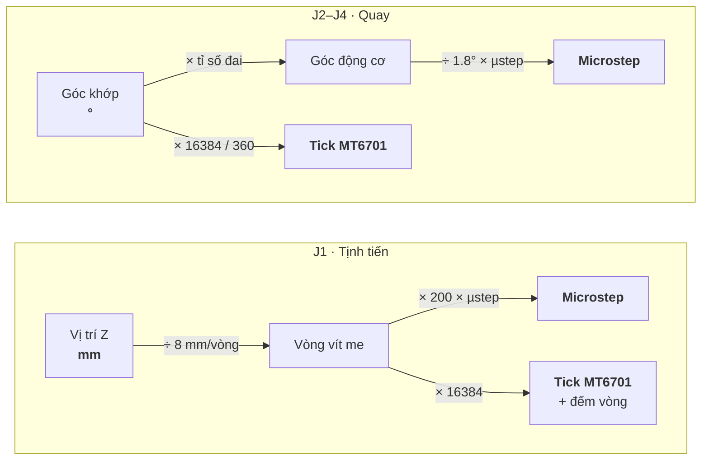

| Khớp | Công thức | Bước / đơn vị | Độ phân giải bước | Độ phân giải encoder |
|:----:|-----------|:-------------:|:-----------------:|:--------------------:|
| J1 | 200 × 16 ÷ 8 mm | 400 bước/mm | **0.0025 mm** | 0.00049 mm |
| J2 | 200 × 16 × 10 | 32 000 bước/vòng | 0.01125° | 0.022° |
| J3 | 200 × 16 × 8  | 25 600 bước/vòng | 0.0141° | 0.022° |
| J4 | 200 × 16 × 3  | 9 600 bước/vòng  | 0.0375° | 0.022° |

> ℹ️ Ở cuối cánh tay (r = 270 mm), 0.022° của J2 tương đương ≈ **0.1 mm** — đủ cho pick & place.

---

## 10. Web điều khiển & giao thức

### 10.1 Giao diện web

Robot tự phát web — mở trình duyệt trên **điện thoại / máy tính** là điều khiển được, **không cần cài app**, **không cần Internet**.

<p align="center"></p>

| Khu vực | Chức năng |
|---------|-----------|
| 🔝 Thanh trên | Trạng thái kết nối, `state`, đã homing chưa, ai đang giữ quyền điều khiển, nút **DỪNG KHẨN** (phím `Space`) |
| 🗺️ Mô phỏng | Vẽ cánh tay **real-time** (nhìn từ trên) + thanh Z, vùng với tới, vết TCP; **click để đặt đích** → xem trước tư thế IK trước khi chạy |
| 📍 Vị trí TCP | X, Y, Z, φ và nghiệm khuỷu hiện tại, cập nhật 20 Hz |
| 🎚️ Jog khớp | J1–J4: **giữ nút** để chạy, kéo slider để đi tới giá trị |
| ✛ Jog Descartes | X±, Y±, Z±, φ± theo bước 0.1 / 1 / 10 hoặc liên tục; hỗ trợ bàn phím |
| ⚡ Tốc độ & tay kẹp | Override tốc độ 1–100 %, mở / kẹp, lực kẹp (%) |
| 📝 Teach & Play | Lưu điểm hiện tại, sửa / xóa, chạy, tạm dừng, lặp; lưu file `.json` trên LittleFS, xuất / nhập |
| 🩺 Trạng thái | Sức khỏe encoder, following error, limit Z, lỗi gần nhất; Enable / Home / Xóa lỗi |
| ⌨️ Console | Gõ trực tiếp G-code như qua Serial |

**Truy cập:**

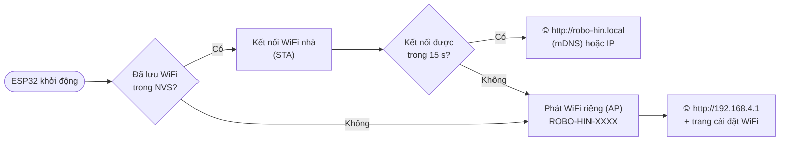

### 10.2 Kiến trúc web

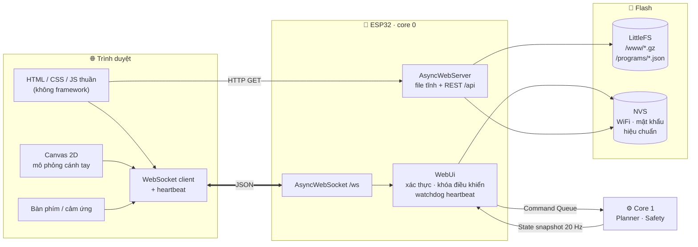

| Thành phần | Lựa chọn | Lý do |
|------------|----------|-------|
| Web server | `ESPAsyncWebServer` + `AsyncTCP` | Bất đồng bộ, chạy trên core 0, không chặn điều khiển |
| Giao tiếp real-time | WebSocket JSON | 2 chiều, độ trễ thấp (~10–30 ms trong LAN) |
| Frontend | HTML + JS thuần + Canvas 2D | Không cần build, **< 150 KB** (gzip), chạy offline — không tải gì từ CDN |
| Lưu file web | LittleFS (`data/www/`), nén `.gz` | Nạp riêng bằng `pio run -t uploadfs`, sửa web không cần nạp lại firmware |
| Chương trình teach | `/programs/*.json` trên LittleFS | Giữ lại sau khi tắt nguồn |

### 10.3 An toàn khi điều khiển qua web

> ⚠️ WiFi **có thể mất bất cứ lúc nào**. Nút DỪNG KHẨN trên web chỉ là lệnh phần mềm — **E-stop vật lý vẫn bắt buộc**.

| Cơ chế | Hoạt động |
|--------|-----------|
| 🫀 **Deadman / heartbeat** | Khi đang jog, trình duyệt gửi `hb` mỗi 100 ms. Không nhận `hb` trong **300 ms** → robot dừng có giảm tốc |
| 🔌 **Mất kết nối** | WebSocket đóng → dừng jog ngay, **tạm dừng** chương trình đang chạy (cấu hình được) |
| 🔒 **Khóa điều khiển** | Chỉ **1 client** giữ quyền điều khiển; các client khác chỉ xem. Muốn giành quyền phải bấm "Nhận điều khiển" |
| 🔑 **Xác thực** | Mật khẩu web (lưu NVS) → token phiên; AP dùng WPA2 |
| ✅ **Cùng đường kiểm tra** | Lệnh từ web đi qua **cùng** soft limit / IK / state machine như Serial — web không có "đường tắt" |
| ⛔ **Ưu tiên E-stop** | `estop` được xử lý trước mọi lệnh khác trong hàng đợi |
| 🔄 **OTA** | Chỉ cho phép cập nhật firmware khi robot ở `Disabled` |

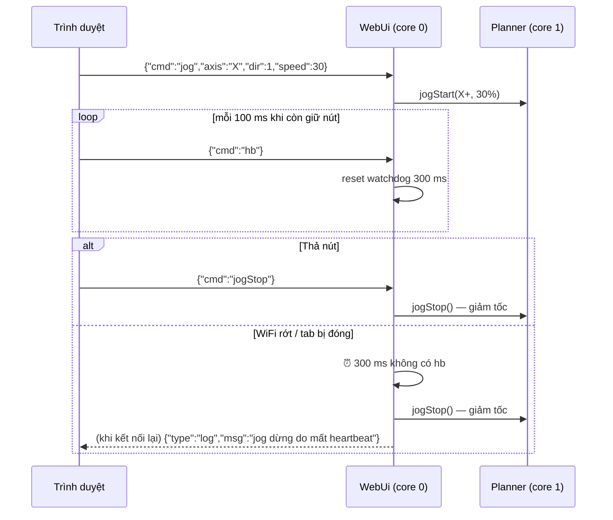

### 10.4 WebSocket JSON — `ws://robo-hin.local/ws`

**Trình duyệt → ESP32** (`cmd`):

| `cmd` | Ví dụ | Ý nghĩa |
|-------|-------|---------|
| `hello` | `{"cmd":"hello","token":"…"}` | Xác thực, nhận quyền **xem** |
| `takeControl` | `{"cmd":"takeControl"}` | Xin quyền **điều khiển** |
| `jog` / `jogStop` / `hb` | `{"cmd":"jog","axis":"J2","dir":-1,"speed":30}` | Jog giữ nút + heartbeat |
| `step` | `{"cmd":"step","axis":"Z","delta":1.0}` | Jog từng bước (mm / °) |
| `moveJ` | `{"cmd":"moveJ","joints":[100,45,-30,0],"speed":50,"id":17}` | Như `robot.moveJ()` |
| `moveL` | `{"cmd":"moveL","pose":[200,50,40,0],"speed":40,"id":18}` | Như `robot.moveL()` |
| `gripper` | `{"cmd":"gripper","pct":80}` | 0 = mở, 100 = kẹp hết |
| `home` · `enable` · `disable` · `clearFault` | `{"cmd":"home"}` | |
| `estop` | `{"cmd":"estop"}` | 🛑 Dừng khẩn (ưu tiên cao nhất) |
| `gcode` | `{"cmd":"gcode","line":"G1 X200 Y50 Z40"}` | Console |
| `prog` | `{"cmd":"prog","op":"run","name":"pick_place","loop":0}` | Teach & Play: `run` / `pause` / `stop` / `savePoint` |

**ESP32 → trình duyệt** (`type`):

| `type` | Tần suất | Nội dung |
|--------|:--------:|----------|
| `state` | 20 Hz | `state`, `homed`, `joints`, `pose`, `elbow`, `speed`, `gripper`, `prog` (bước đang chạy) |
| `diag` | 2 Hz | Sức khỏe encoder, following error, limit Z, RSSI, heap trống |
| `ack` | theo lệnh | `{"type":"ack","id":17,"status":"queued" \| "done" \| "error","code":3}` |
| `fault` | sự kiện | Mã lỗi + mô tả |
| `control` | sự kiện | Ai đang giữ quyền điều khiển |
| `log` | sự kiện | Dòng console |

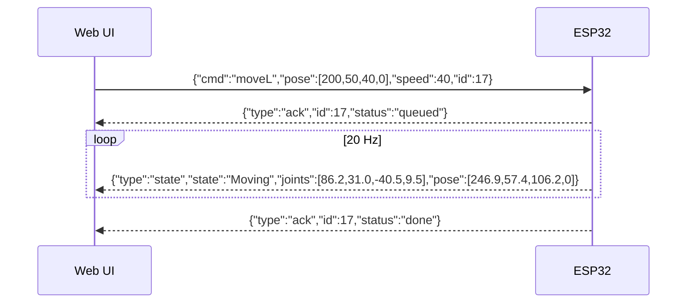

### 10.5 REST API

| Method | Đường dẫn | Ý nghĩa |
|--------|-----------|---------|
| `GET` | `/` | Giao diện web (file tĩnh từ LittleFS) |
| `GET` | `/api/info` | Phiên bản firmware, hình học robot (a₂, a₃, giới hạn khớp) để web tự vẽ đúng tỉ lệ |
| `GET` | `/api/programs` | Danh sách chương trình teach |
| `GET` · `PUT` · `DELETE` | `/api/programs/{name}` | Đọc / lưu / xóa 1 chương trình |
| `POST` | `/api/wifi` | Lưu SSID / mật khẩu WiFi → khởi động lại |
| `POST` | `/update` | Cập nhật firmware OTA (cần đăng nhập, robot phải `Disabled`) |

**Định dạng chương trình teach** (`/programs/pick_place.json`):

```json
{
  "name": "pick_place",
  "speed": 50,
  "steps": [
    { "op": "moveJ",   "pose": [200, 50, 120, 0],  "gripper": 0 },
    { "op": "moveL",   "pose": [200, 50,  40, 0],  "gripper": 100 },
    { "op": "moveL",   "pose": [200, 50, 120, 0] },
    { "op": "moveJ",   "pose": [ 50, 220, 120, 90] },
    { "op": "moveL",   "pose": [ 50, 220,  40, 90], "gripper": 0 },
    { "op": "wait",    "ms": 500 }
  ]
}
```

### 10.6 Serial — dạng G-code (115200 baud, kết thúc `\n`)

| Lệnh | Ví dụ | Ý nghĩa |
|------|-------|---------|
| `G0` | `G0 J1=100 J2=45 J3=-30 J4=0 F50` | moveJ (J1 mm, J2–J4 độ), `F` = % tốc độ |
| `G1` | `G1 X200 Y50 Z40 A0 F40` | moveL, `A` = góc tay kẹp φ, `F` = mm/s |
| `G28` | `G28` | Homing J1 (limit Z) |
| `M50` | `M50 L` / `M50 R` | Chọn nghiệm khuỷu trái / phải |
| `M3` / `M5` | `M3 S80` / `M5` | Đóng gripper (S = %) / mở |
| `M17` / `M18` | | Bật / tắt động cơ |
| `M112` | | 🛑 **Dừng khẩn cấp** |
| `M114` | | Báo vị trí hiện tại |
| `M119` | | Trạng thái công tắc, E-stop, encoder |
| `M500` | | Lưu hiệu chuẩn vào NVS |
| `M999` | | Xóa lỗi |

```text
> M114
< J:100.00,45.01,-29.98,0.00 X:222.0 Y:137.1 Z:120.0 A:15.0
< ok
> G0 J1=300
< error:3 OutOfRange J1 max=200
> G1 X300 Y0 Z50 A0
< error:4 OutOfReach r=300 max=270
```

---

## 11. Hiệu chuẩn

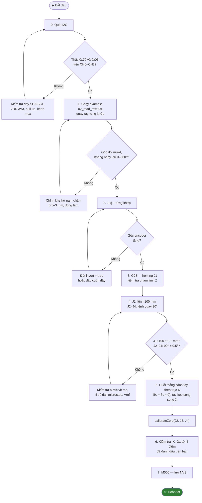

**Chu trình homing J1:**

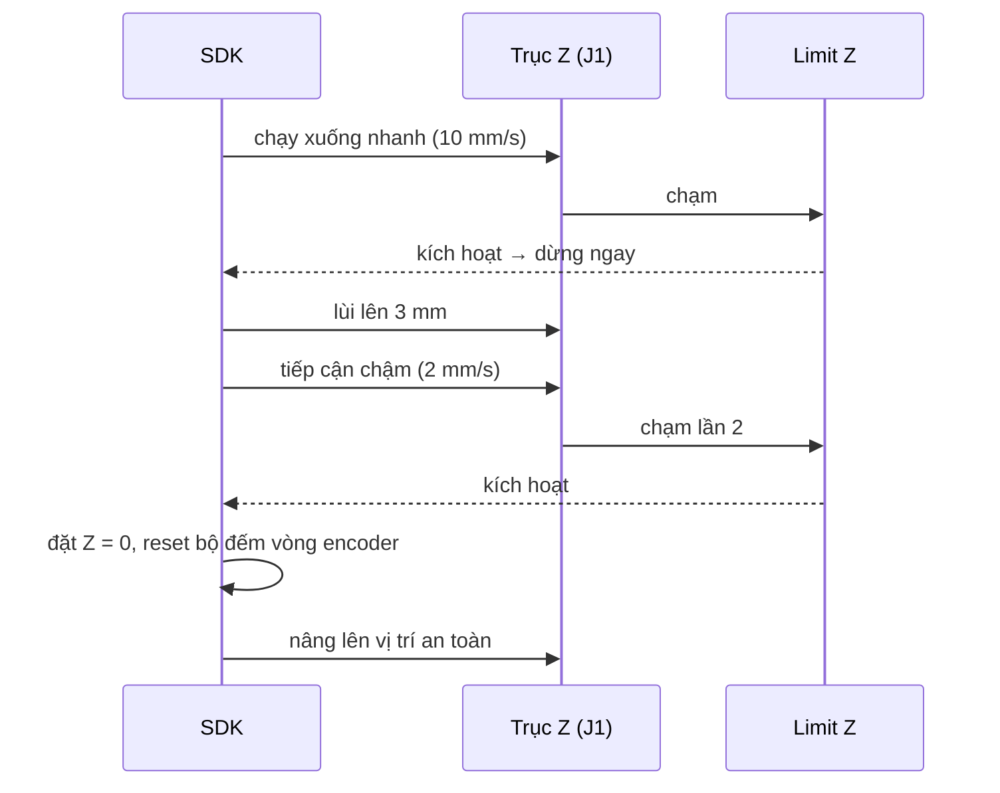

> 💡 Chỉnh dòng A4988: bắt đầu ~70% dòng định mức; tăng nếu mất bước, giảm nếu driver/động cơ quá nóng (> 70 °C).

---

## 12. An toàn & máy trạng thái

> ⚠️ **Tay máy có thể gây thương tích.** Luôn có nút E-stop vật lý trong tầm tay khi thử nghiệm.

### 12.1 Các lớp bảo vệ

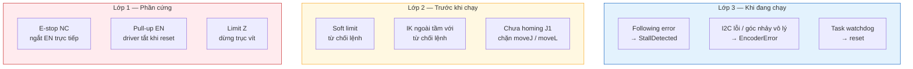

> ⚠️ **Trục Z khi mất điện:** vít me T8 **bước 8 mm (4 đầu mối) không tự hãm**. Khi `disable()` hoặc E-stop, cánh tay có thể tự trôi xuống nếu tải nặng. Có 3 cách: dùng vít T8 **bước 2 mm** (tự hãm), giữ dòng J1 khi dừng, hoặc thêm lò xo / đối trọng.

### 12.2 Máy trạng thái robot

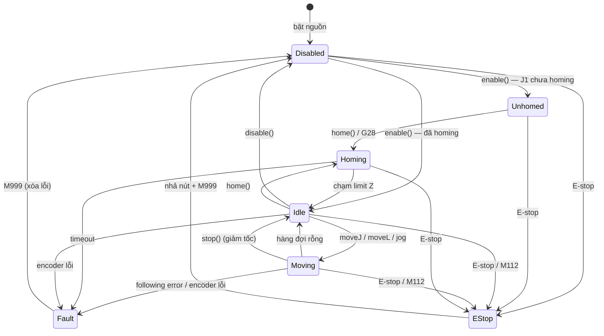

| Trạng thái | Driver | Nhận lệnh chuyển động |
|------------|:------:|:---------------------:|
| `Disabled` | Tắt | ❌ |
| `Unhomed`  | Bật | ❌ — chỉ `home()` và `jog` |
| `Idle`     | Bật | ✅ |
| `Homing`   | Bật | ❌ (chỉ `stop`) |
| `Moving`   | Bật | ✅ (xếp hàng) |
| `Fault`    | **Tắt** | ❌ — cần `M999` |
| `EStop`    | **Tắt** | ❌ — cần nhả nút + `M999` |

---

## 13. Build, nạp và kiểm thử

### 13.1 `platformio.ini` đề xuất

```ini
[platformio]
default_envs = esp32dev

[env]
build_flags = -std=gnu++17 -Wall -Wextra
build_unflags = -std=gnu++11

[env:esp32dev]
platform = espressif32
board = esp32dev
framework = arduino
monitor_speed = 115200
monitor_filters = esp32_exception_decoder
board_build.filesystem = littlefs
build_flags =
    ${env.build_flags}
    -DCORE_DEBUG_LEVEL=3
    -DHIN_LOG_LEVEL=3
lib_deps =
    bblanchon/ArduinoJson@^7
    ESP32Async/AsyncTCP
    ESP32Async/ESPAsyncWebServer

; Unit test thuần C++ (kinematics, profile, giải mã encoder) trên PC
[env:native]
platform = native
test_filter = test_kinematics, test_profile, test_mt6701_decode
build_flags = ${env.build_flags} -DHIN_NATIVE
```

### 13.2 Quy trình phát triển

```mermaid
flowchart LR
    E["✏️ Sửa code"] --> T["🧪 pio test -e native<br/>(PC, vài giây)"]
    T -- "fail" --> E
    T -- "pass" --> B["🔨 pio run"]
    B --> U["⬆️ pio run -t upload"]
    U --> M["📟 pio device monitor"]
    M --> HW["🦾 Thử trên robot<br/>(tay đặt trên E-stop)"]
    HW -- "lỗi" --> E
```

```bash
pio run                       # build
pio run -t upload             # nạp firmware
python tools/gzip_www.py      # nén file web trong data/www
pio run -t uploadfs           # nạp giao diện web vào LittleFS
pio device monitor            # Serial monitor
pio test -e native            # unit test trên PC
pio test -e esp32dev          # test trên board thật
```

---

## 14. Quy ước code

| Hạng mục | Quy ước |
|----------|---------|
| Ngôn ngữ | **C++17**, mọi thứ trong `namespace hin` |
| Tên class / kiểu | `PascalCase` — `MotionPlanner` |
| Hàm / biến | `camelCase` — `moveJ`, `targetDeg` |
| Hằng số | `kPascalCase` — `kMaxJoints` |
| Thành viên private | hậu tố `_` — `position_` |
| Bộ nhớ | **Không cấp phát động** sau `begin()`; không cấp phát trong ISR |
| ISR | `IRAM_ATTR`, không `Serial`, không `float` nếu tránh được |
| Lỗi | Trả `hin::Status`, không exception |
| Tính di động | `kinematics/`, `motion/Profile`, giải mã encoder không phụ thuộc Arduino |
| Định dạng | `clang-format` (Google style, indent 4) |
| Đóng góp | Mỗi tính năng mới kèm ví dụ trong `examples/` hoặc test trong `test/` |

---

## 15. Lộ trình phát triển

```mermaid
flowchart LR
    P0["<b>0 · Nền tảng</b><br/>cấu trúc, Status,<br/>logging, CI"]
    P1["<b>1 · Một trục</b><br/>StepPulseGen<br/>A4988, profile"]
    P2["<b>2 · Encoder</b><br/>MT6701 I2C + TCA9548A<br/>đếm vòng"]
    P3["<b>3 · Vòng kín</b><br/>Joint<br/>following error"]
    P4["<b>4 · Đa trục</b><br/>Homing Z, Planner<br/>E-stop, limit"]
    P5["<b>5 · Động học</b><br/>SCARA FK / IK<br/>moveL"]
    P6["<b>6 · Giao tiếp</b><br/>G-code<br/>NVS"]
    P7["<b>7 · Web điều khiển</b><br/>WiFi, WebSocket, UI<br/>teach & play, OTA"]
    P8["<b>8 · Mở rộng</b><br/>S-curve, 3D view<br/>TMC2209, ROS 2"]
    P0 --> P1 --> P2 --> P3 --> P4 --> P5 --> P6 --> P7 --> P8
    style P0 fill:#fff3e0,stroke:#e65100
```

| Giai đoạn | Kết quả kiểm chứng |
|-----------|--------------------|
| 0 · Nền tảng | `pio run` + `pio test -e native` chạy được |
| 1 · Một trục | Example 01: 1 động cơ quay êm, không trượt bước |
| 2 · Encoder | Example 02: góc ổn định, nhiễu < 0.05° |
| 3 · Vòng kín | Example 03: chặn tay động cơ → báo stall |
| 4 · Đa trục | Example 04: homing Z lặp lại ± 0.02 mm · Example 05: 4 khớp tới đích cùng lúc |
| 5 · Động học | Test `IK(FK(q)) == q` cả 2 nghiệm khuỷu; Example 06 vẽ đường thẳng / hình vuông |
| 6 · Giao tiếp | Example 07: điều khiển từ terminal |
| 7 · Web điều khiển | Example 08: jog + teach & play từ điện thoại; tắt WiFi khi đang jog → robot dừng ≤ 300 ms |
| 8 · Mở rộng | — |

---

## 16. Tài liệu tham khảo

- 📄 MT6701 Datasheet — MagnTek
- 📄 A4988 Datasheet — Allegro MicroSystems · Pololu A4988 Stepper Driver Carrier
- 📄 TCA9548A Datasheet — Texas Instruments
- 📄 ESP32 Technical Reference Manual — Espressif (RMT, GPTimer, I2C, LEDC)
- 📘 ESP-IDF Programming Guide — FreeRTOS SMP, NVS, Task Watchdog
- 📚 J. J. Craig — *Introduction to Robotics: Mechanics and Control*
- 📚 K. M. Lynch & F. C. Park — *Modern Robotics*
- 🔧 PlatformIO Docs — Unit Testing, Library Dependency Finder

---

<div align="center">

**MIT License** · Tác giả: **HIN** — huynh.technical@gmail.com

</div>
